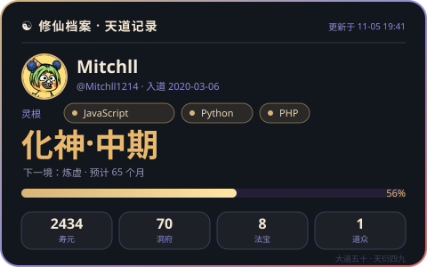
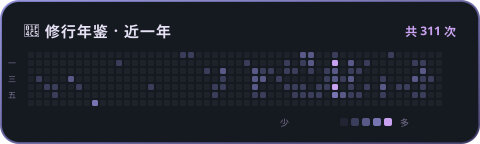
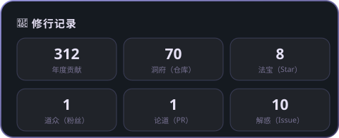
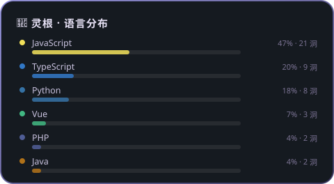
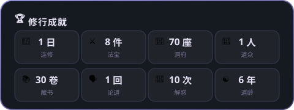

<!-- 1. 道号横幅（自建 SVG + SMIL 横向滚动字幕） -->

  <h4>🪷 道号横幅 · 因果不虚</h4>
  

<!-- 2. 洞府主人 -->

  
  <h3>👋 你好，我是 Mitchll</h3>
  
本洞府一切数据皆由天道 <b>（GitHub Actions）</b> 每日自行采撷推演，不假外物，无染旁门。

---

<!-- 3. 修仙档案 · 境界由注册时长自动定境（练气→飞升） -->

  <h4>☯️ 修仙境界 · 自动定境</h4>
  

 

<!-- 4. 虚拟灵宠 · 龙仔（由近期活跃度驱动成长与心情） -->

  <h4>🐲 灵兽谱 · 以行饲之</h4>
  

---

<!-- 5. 修行年鉴 · 近一年贡献热力图（自建） -->

  <h4>📅 岁修录 · 天道铭之</h4>
  

 

<!-- 6. 修行记录 + 灵根（自建统计卡） -->

  <h4>📜 修行记录 · 六项指标</h4>
  
    
  <h4>🧬 灵根 · 语言分布</h4>
  

---

<!-- 7. 星图推衍 · 以行铸辰（历史累计提交 → 星图等级） -->

  <h4>✨ 星图推衍 · 以行铸辰</h4>
  

 

<!-- 8. 今日星轨 · 勤修不辍（今日提交 → 今日星辰缀入星轨） -->

  <h4>🌠 今日星轨 · 勤修不辍</h4>
  

<!-- 9. 修行成就 -->

  <h4>🏆 修行成就 · 称号一览</h4>
  

---

  
🧿 玩法说明 & 更新机制

  

    <b>☯ 修仙境界</b>（天道记录卡）：以注册 GitHub 的时长自动定境（练气 → 筑基 → 金丹 → 元婴 → 化神 → 炼虚 → 合体 → 大乘 → 渡劫 → 飞升），境界内分初期/中期/后期；寿元、洞府（仓库）、法宝（Star）、道众（粉丝）、灵根（常用语言）、灵力进度条均每日自动刷新。 
    <b>🐲 灵宠「龙仔」</b>：Q 萌小青龙，随活跃度成长 —— 近一年贡献推动它从 <b>龙蛋 → 幼龙 → 青龙 → 应龙 → 神龙</b>；近 30 日贡献为灵力条，最长连续提交为亲密度；今日有提交则"龙行云海"。<b>今日提交、连续天数、近 30 日均按北京自然日（UTC+8）精确统计</b>，不再受 GitHub 贡献日历按 UTC 分日导致的凌晨错位影响。 
    <b>📅 修行年鉴 / 📜 修行记录 / 🧬 灵根 / 🏆 修行成就</b>：近一年贡献热力图，以及年度贡献、洞府、法宝、道众、论道（PR）、解惑（Issue）等指标一览；灵根即你最常用的编程语言。热力图与「年度贡献」沿用 GitHub 贡献日历口径（commit + issue + PR + review），与纯提交数略有差异。 
    <b>✨ 星图推衍 · 以行铸辰</b>：把每一次提交看作点亮一颗星辰，历史累计提交数按总量定级（星尘初现 → 星火燎原 → 星罗棋布 → 星河初成 → 星域纵横 → 万星朝宗），星辰数量随等级递增；统计覆盖自有 / 协作 / 所属组织的仓库（含 fork，<b>配置 <code>PROFILE_TOKEN</code> 后含私有库</b>），仅计<b>本人提交</b>，自动化脚本（bot）不计入。 
    <b>🌠 今日星轨 · 勤修不辍</b>：今日提交沿微弱弧线缀入星轨（高亮金色大星并发光），今日无提交则显示一颗暗淡星与「今日未入道」；今日数同样按北京自然日精确统计。
  

  

    <b>更新机制</b>：<code>.github/workflows/update-profile.yml</code> 定时（每天 08:00 / 12:00 / 15:00 / 17:00 / 22:00 北京时间）或手动触发，调 GitHub 官方 API 实时采集数据，按 <code>api/</code>（修仙档案/灵宠）、<code>scripts/</code>（横幅/年鉴/记录/灵根/成就/星图）中的代码重新渲染全部卡片并提交回仓库 —— 全程只依赖 GitHub 自身，不调用任何第三方平台。 
    <b>数据范围</b>：默认使用 Actions 内置的 <code>GITHUB_TOKEN</code>，它只能读取<b>公开仓库</b>；若要让私有库的提交、语言、Star、PR、Issue 也计入，请在仓库 Settings → Secrets 添加 <code>PROFILE_TOKEN</code>（fine-grained PAT，读权限 <code>Contents</code>，并按需勾选私有仓库）。配置后脚本优先使用它，未配置则自动回退。 
    <b>口径</b>：GitHub 贡献日历（热力图/年度贡献）按 UTC 分日，且包含 commit + issue + PR + review；<b>今日提交、连续天数、近 30 日</b>改用 <code>committer-date</code> 按北京自然日精确统计（近 90 天），因此两者数值可能不同，属预期行为。GitHub 提交索引有数分钟延迟，Actions 定时任务也可能延后，卡片右下角的「更新于」为实际生成时间。 
    修改卡片样式：编辑 <code>api/</code> 或 <code>scripts/</code> 下的代码（<code>local/</code> 与 workflow 文件本身也在 push 触发范围内）后 push，workflow 会自动拉取最新数据、用新代码重新生成全部卡片；也可在仓库 Actions 页手动点击 <b>Run workflow</b> 立即刷新。 
    ⚠ <code>images/</code> 下的 SVG 均为自动生成产物：手动编辑会被下次生成覆盖；且仅改动 <code>README.md</code> 或 <code>images/</code> 不会触发自动更新。 
    本地预览：<code>node local/generate.js --mock</code>（合成数据）→ 查看 <code>images/</code> 下的 SVG；或 <code>node local/server.js</code> → <code>http://localhost:8787/preview</code>。
  

